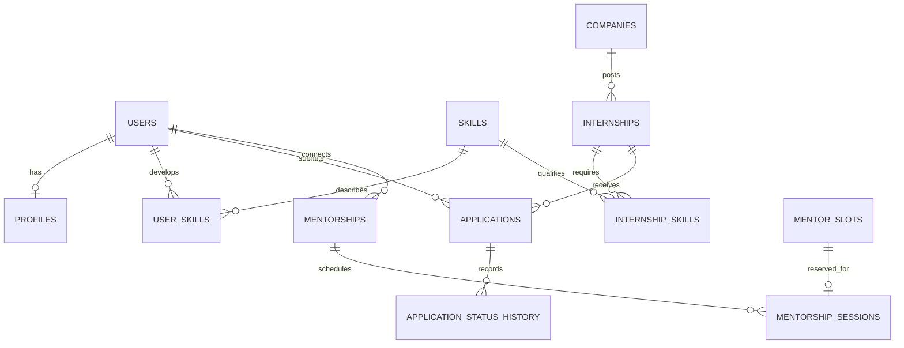

# SkillBridge database design

SkillBridge uses MySQL for structured relationships and reliable transactions, and MongoDB for mentorship notes and evolving action lists. No AI or vector database is involved.

## ER diagram



MongoDB records reference the matching MySQL mentorship or session ID. The API verifies that the current user is a participant before reading or changing these documents.

## Relational data dictionary

| Table | Primary key | Purpose |
|---|---|---|
| `users` | `id` | Unique email, password hash, role and mentor approval |
| `profiles` | `user_id` | One-to-one biography and organization |
| `skills` | `id` | Shared skill catalog |
| `user_skills` | `(user_id, skill_id)` | Student proficiency or mentor expertise, 1 beginner to 4 expert |
| `companies` | `id` | Internship employer |
| `internships` | `id` | Listing, stipend, location, closing time and active state |
| `internship_skills` | `(internship_id, skill_id)` | Requirement weight and minimum proficiency |
| `applications` | `id` | Student application and current status |
| `application_status_history` | `id` | Status change, actor and timestamp |
| `mentorships` | `id` | Unique student and mentor connection |
| `mentor_slots` | `id` | Mentor availability start and end |
| `mentorship_sessions` | `id` | Slot reservation, state and feedback rating |
| `auth_sessions` | `token_hash` | Hashed browser-session token and expiry |
| `schema_migrations` | `version` | Additive schema upgrade record |

Foreign keys preserve relationships. Uniqueness rules prevent duplicate applications, duplicate student–mentor connections and reserving the same active slot twice. Enum and check constraints validate roles, status, proficiency, rating, stipend and time range. `open_internships` is a SQL view over active, unexpired listings. Indexes support foreign-key joins, mentor schedules, session lookup and journal timelines.

## MongoDB data model

`journal_entries` holds mentorship reflections. `session_notes` records discussion notes tied to a meeting. Both documents contain SQL `relationship_id`, `author_id`, `author_name`, `body`, optional `tasks` (`title` and `done`), and `created_at`; session notes also include `session_id`. Both collections have a schema validator and a compound `{relationship_id: 1, created_at: -1}` index. Text and action items can evolve without adding SQL columns. Participant checks remain in the API because MongoDB cannot enforce a foreign key to MySQL.

## Rule-based match

Each critical, required and preferred skill is weighted 3, 2 and 1. A student meets a requirement if their proficiency reaches its minimum. The percentage is `100 × weights of met skills / weights of all requested skills`, rounded to the nearest whole number. Missing a critical skill blocks an application. A role without skill requirements has no score. Results display the exact met requirements and gaps.

## Database operations to discuss

Application submission uses one SQL transaction: lock an open listing, check critical skills, insert the application and add its initial history row. Each subsequent status transition locks the application, checks that the state change is allowed, and writes its audit history.

Booking locks the student and chosen availability, checks the accepted mentoring relationship and schedule conflict, and inserts the reservation in one transaction. The unique active-slot index protects against two requests arriving at once. The integration suite races two students against one slot; exactly one reservation should succeed.

The project demonstrates the SQL view, foreign keys, unique/check constraints, indexes, transactions, joins and grouped reports, plus MongoDB validation and an aggregation report. See example presentation queries below.

```sql
-- Listings and applicant totals, including listings with no applicants
SELECT i.title, c.name AS company, COUNT(a.id) AS applications
FROM open_internships AS i
JOIN companies AS c ON c.id = i.company_id
LEFT JOIN applications AS a ON a.internship_id = i.id
GROUP BY i.id, i.title, c.name
HAVING COUNT(a.id) >= 0
ORDER BY applications DESC, i.title;

-- Application status history, with the person who changed it
SELECT a.id, i.title, h.status, u.name AS changed_by, h.created_at
FROM applications AS a
JOIN internships AS i ON i.id = a.internship_id
JOIN application_status_history AS h ON h.application_id = a.id
JOIN users AS u ON u.id = h.actor_id
ORDER BY h.created_at;

-- Mentor feedback summary
SELECT u.name, COUNT(ms.id) AS completed_sessions,
       ROUND(AVG(ms.feedback_rating), 1) AS average_rating
FROM users AS u
JOIN mentorships AS m ON m.mentor_id = u.id
JOIN mentorship_sessions AS ms ON ms.mentorship_id = m.id
WHERE u.role = 'mentor' AND ms.status = 'completed'
GROUP BY u.id, u.name
ORDER BY completed_sessions DESC;
```

MongoDB's report groups journal entries by `relationship_id` and counts each student's progress history. The app combines this report with SQL application totals.
